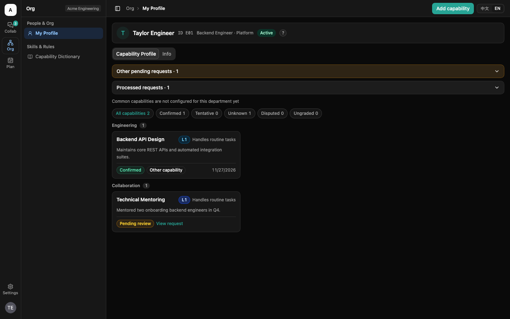
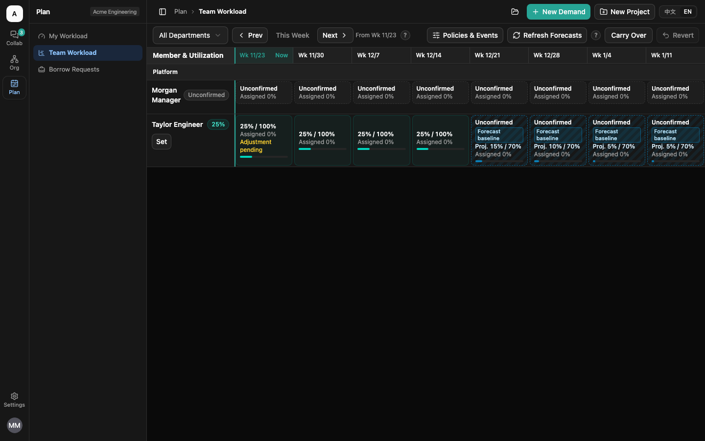
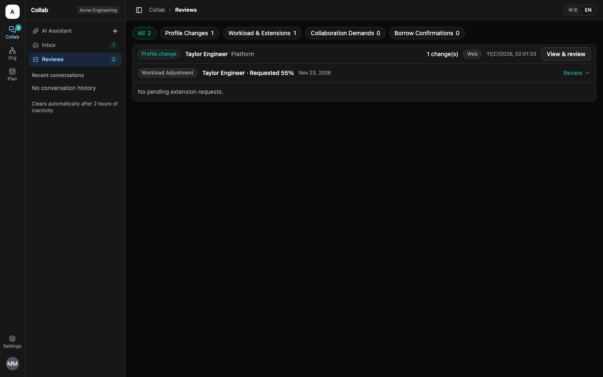
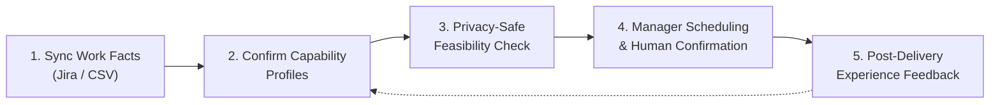

<h1 align="center">OrgPace</h1>

<p align="center">
  <strong>Turn real team capabilities and live workload into conflict-free project schedules — unblock cross-team bottlenecks and ship faster.</strong><br />
  A self-hosted project scheduling and cross-team delivery engine grounded in real capability profiles and live team capacity.
</p>

<p align="center">
  <a href="#product-tour">Product Tour</a> ·
  <a href="#how-it-works">How It Works</a> ·
  <a href="#roadmap">Roadmap</a> ·
  <a href="#quick-start">Quick Start</a> ·
  <a href="docs/README.md">Docs</a> ·
  <a href="README_CN.md">简体中文</a>
</p>

<p align="center">
  <a href="LICENSE"></a>
  
  
</p>

## Why This Exists

Projects rarely stall because people aren't working hard—they stall when cross-team requests bounce around with no clear availability, key experts silently carry hidden overload, and schedules are built on guesswork in static spreadsheets. OrgPace grounds scheduling in **real capability profiles and live 70%/30% resource workload** to surface and clear bottlenecks across people and departments, keep plans realistic, and move delivery forward faster.

| Area | Traditional Approach | OrgPace |
| :--- | :--- | :--- |
| **Capability Foundation** | Rely on memory, self-claimed tags, or outdated HR sheets | Capability profiles drafted from Jira or CSV work records, reviewed by employees, and approved by managers |
| **Workload &amp; Headroom** | Guess availability in Excel with 100% static assumptions | Visual weekly workload with a 70% regular quota, 30% elastic buffer, and forward availability forecasting |
| **Cross-Team Bottlenecks** | Chase people across chats or expose everyone's private calendar | Check cross-team schedule feasibility and earliest start dates without exposing personal details; managers assign privately |
| **Executable Commitments** | Verbal promises or unverified AI suggestions | Rule-checked scheduling cards with explicit human confirmation before any commitment goes live |

**A typical day with OrgPace:**

1. **Ground Schedules in Real Work Facts:** Sync Jira issues or import CSV work logs to keep capability profiles accurate—never relying on stale HR tags or guesswork.
2. **Unblock Cross-Team Requests Early:** State project goals, required skills, and target timelines to see which teams can take the work and how soon they can start, without exposing individual calendars.
3. **Schedule Within Real Headroom &amp; Confirm Explicitly:** Receiving managers review 70%/30% workload forecasts to avoid overloading key contributors, adjust assignments visually, and confirm commitments in the web workbench or Feishu.
4. **Feed Delivery Outcomes Back into Growth:** Once a milestone ships, factual delivery feedback flows back into the contributor's review queue to strengthen future staffing and scheduling decisions.

## Product Tour

1440×900 English desktop screenshots captured using synthetic demo data (`Acme Engineering`):

<table>
  <tr>
    <td width="50%" align="center">
      <a href="docs/assets/readme/03-my-profile-en.png"></a><br />
      <sub><strong>Capability Foundation</strong> — View confirmed and pending capabilities backed by traceable work facts; unknown skills stay unmarked.</sub>
    </td>
    <td width="50%" align="center">
      <a href="docs/assets/readme/05-capacity-workload-en.png"></a><br />
      <sub><strong>Team Workload &amp; Headroom</strong> — Track weekly allocations, 70% regular quotas, forward forecast baselines, and policy adjustments.</sub>
    </td>
  </tr>
  <tr>
    <td width="50%" align="center">
      <a href="docs/assets/readme/04-reviews-en.png"></a><br />
      <sub><strong>Unified Reviews Queue</strong> — Approve capability updates, workload adjustments, and cross-team requests in one queue with org-level delegation.</sub>
    </td>
    <td width="50%" align="center">
      <a href="docs/assets/readme/07-assistant-en.png"></a><br />
      <sub><strong>Work Assistant</strong> — Query team readiness, draft updates, or prepare schedules in English or Chinese within your permission scope.</sub>
    </td>
  </tr>
</table>

## How It Works



1. **Sync Work Facts:** Connect Jira Cloud/Data Center or upload CSV work records so capability drafts reflect real contributions.
2. **Confirm Capability Profiles:** Employees review and edit drafted skills; managers (or higher-level org leads when delegated) approve changes before publication.
3. **Privacy-Safe Feasibility Check:** Requesters evaluate which departments can support a demand or multi-role project and when they can start—with zero individual exposure.
4. **Manager Scheduling &amp; Human Confirmation:** Receiving managers adjust internal assignments against weekly capacity and forecast headroom, then confirm commitments via web or Feishu cards.
5. **Post-Delivery Experience Feedback:** After delivery wraps up, factual manager feedback is reviewed by the contributor and added back into their capability profile.

## Roadmap

We strictly separate capabilities running today from upcoming product features.

| Capability Area | Status | What It Delivers |
| :--- | :---: | :--- |
| **Capability Profiles** | ✅ **Available Now** | Jira/CSV work sync, employee self-review, and org-delegated manager approval |
| **Workload &amp; Forecasting** | ✅ **Available Now** | Weekly availability, 70% regular + 30% elastic quota, and forward headroom forecasts |
| **Cross-Team Scheduling** | ✅ **Available Now** | Privacy-safe feasibility checks, visual card scheduling, and human confirmation |
| **Multi-Role Projects &amp; Growth** | ✅ **Available Now** | Phased multi-role delivery tracking and post-delivery feedback into profiles |
| **Bilingual UI &amp; Channels** | ✅ **Available Now** | EN / 简体中文 switching, built-in assistant, and Feishu interactive cards |
| **Automated Project Scheduling** | 🚧 **Coming Next** | Turn goals, dependencies, and live capacity into conflict-free project schedules |
| **Goal-First Cross-Team Staffing** | 🚧 **Coming Next** | Discover contributors across permitted scopes directly from business goals |
| **Smart Breakdown &amp; Pairing** | 🚧 **Coming Next** | Strength-based task breakdown and senior-junior pairing when experts are full |
| **Global Bottleneck &amp; Risk Views** | 🚧 **Coming Next** | Unified timeline plus people/department bottleneck and schedule risk views |
| **Live Impact &amp; Light Re-Planning** | 🚧 **Coming Next** | Rapid impact checks and minimal-disruption re-planning when changes hit |
| **Ecosystem &amp; Production** | 🚧 **Coming Next** | Slack / Microsoft Teams integrations and streamlined production HTTPS guides |

### ✅ Available Now

- **Trusted Capability Profiles:** Automatically draft member capabilities from Jira or imported work records, finalized only after employee self-review and manager approval (with automatic org-hierarchy delegation); only traceable work facts are recorded, and unknown stays unknown.
- **Live Workload &amp; Forward Forecasting:** Members maintain weekly availability and unavailability windows; OrgPace separates a 70% regular quota from a 30% elastic buffer and forecasts future headroom from carry-over trends and business events.
- **Privacy-Safe Cross-Team Feasibility &amp; Confirmed Scheduling:** Requesters state goals and timelines to see whether a target team can take on the work and the earliest start date without seeing personal details; receiving managers adjust assignments in visual cards and confirm commitments explicitly.
- **Multi-Role Project Delivery &amp; Growth Loop:** Coordinate and track multi-role, phased projects; once work is delivered, factual outcomes feed back to enrich team members' capability profiles.
- **Bilingual Experience &amp; Everyday Channels:** One-click English / Chinese switching with remembered preferences across the web workbench, built-in assistant, and Feishu interactive confirmation cards.

### 🚧 Coming Next

- **Automated Project Scheduling:** Convert project goals, phased dependencies, and live team workload into conflict-free schedules ready for manager review and confirmation.
- **Goal-First Cross-Team Staffing:** Start initiatives from business goals without locking in a specific department or fixed slot upfront; discover suitable contributors across permitted scopes and route approvals automatically based on selected members.
- **Smart Work Breakdown &amp; Senior-Junior Pairing:** Suggest work breakdowns tailored to people's combined strengths; when senior experts are overloaded and juniors have headroom, recommend pairing (`light expert review + junior primary execution`) and build proof of capability on completion.
- **Unified Schedule, Bottleneck &amp; Risk Views:** Provide a cross-project collaboration timeline, org-wide people and department bottleneck insights alongside underutilized expertise, and a unified risk view combining task dependencies, collaboration handoffs, and schedule conflicts.
- **Live Change Impact &amp; Lightweight Re-Planning:** When someone takes unexpected leave, an upstream task slips, or scope shifts, rapidly assess impacted delivery dates and propose minimal-disruption schedule adjustments for human approval.
- **Broader Ecosystem &amp; Production Readiness:** Expand IM integrations (such as Slack and Microsoft Teams), complete full production HTTPS deployment guides, and finalize release compliance verification.

## Quick Start

> [!CAUTION]
> **Local Evaluation Only:** The default `.env.example` runs in development mode with placeholder secrets (`changethis`) and synthetic demo accounts. Before deploying to a production or internet-facing server, use `./install.sh` and follow the [Production Deployment Guide](docs/deploy.md).

**Prerequisites:** Docker and Docker Compose (`>= 2.24.4`).

```bash
git clone https://github.com/GSX-Eis/OrgPace.git
cd OrgPace
cp .env.example .env
docker compose up -d --wait
```

Once all services report healthy, open **<http://localhost:8000>** in your browser (use the `中文 / EN` toggle in the top-right corner at any time). Run `docker compose down` to stop while keeping data, or `docker compose down -v` to wipe the local demo database.

<details>
<summary>Synthetic Demo Accounts (automatically loaded with <code>.env.example</code>)</summary>

All organizations, employees, and Jira issues in `examples/demo-org/` are 100% synthetic:

| Role | Email | Password |
| :--- | :--- | :--- |
| **Org Admin** | `admin@demo.example.com` | `demo-password-2026` |
| **Department Manager (`E01`)** | `manager.platform@demo.example.com` | `demo-password-2026` |
| **Employee (`E02`)** | `employee.platform@demo.example.com` | `demo-password-2026` |
| **Platform Superuser** | `admin@example.com` | `changethis` |

</details>

## What This Is NOT

- **Not Employee Surveillance:** We do not track keystrokes, screen time, hours worked, or commit counts. Missing evidence never implies lack of skill, and employees manage their own unavailability windows.
- **No Autonomous AI Commitments:** Neither schedules nor capability profiles go live automatically. Every proposed plan or profile update goes through deterministic rule checks and explicit human confirmation.
- **Not a Financial or Inventory ERP:** There are no accounting ledgers, payroll, or supply-chain modules here—OrgPace focuses strictly on turning real capability and workload visibility into reliable cross-team delivery.

## Documentation &amp; License

- **Documentation:** [Docs Index](docs/README.md) · [Production Deployment](docs/deploy.md) · [Docker Compose Quick Guide](docs/deployment-docker-compose.md) · [Admin Guide](docs/admin-guide.md) · [Manager Guide](docs/manager-guide.md) · [Employee Guide](docs/employee-guide.md) · [Extending Guide](docs/extending.md)
- **License &amp; Contributing:** Licensed under the [Apache License 2.0](LICENSE) (see [NOTICE](NOTICE)), retaining upstream [MIT attribution](licenses/full-stack-fastapi-template-MIT.txt). Third-party dependency verification details are documented in [docs/licenses.md](docs/licenses.md). Contributions are welcome via [CONTRIBUTING.md](CONTRIBUTING.md).
