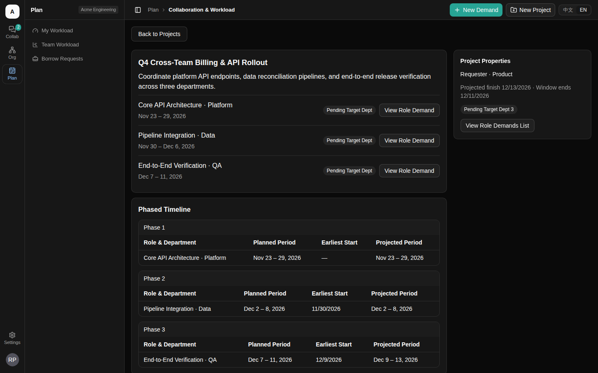
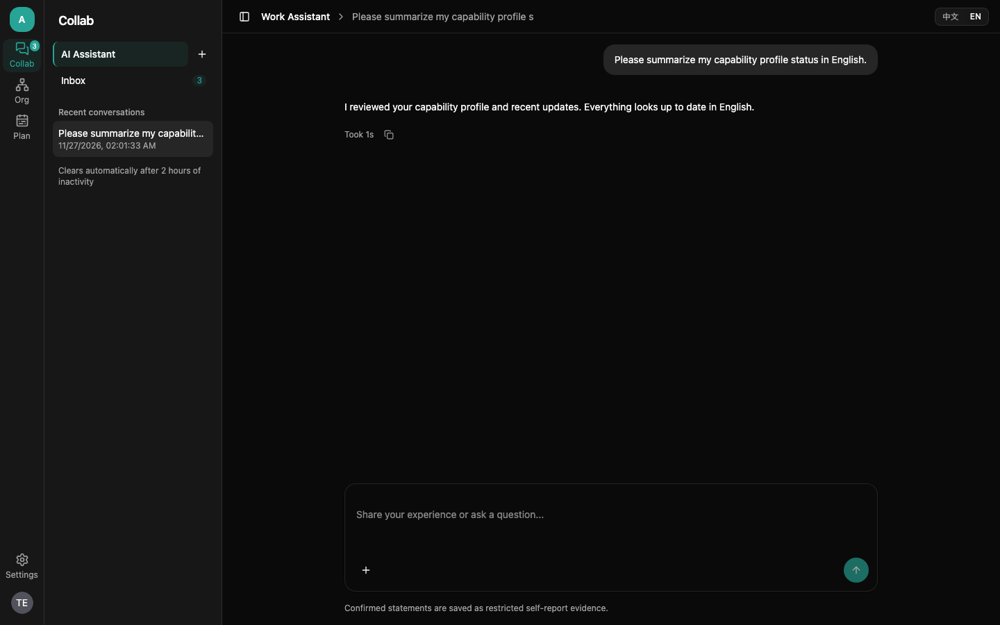
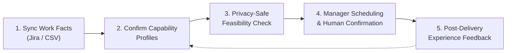

<p align="center">
  <picture>
    <source media="(prefers-color-scheme: dark)" srcset="docs/assets/readme/orgpace-logo-dark.svg" />
    <source media="(prefers-color-scheme: light)" srcset="docs/assets/readme/orgpace-logo-light.svg" />
    
  </picture>
</p>

<h1 align="center">OrgPace</h1>

<p align="center">
  <strong>Turn real team capabilities and live workload into conflict-free project schedules — unblock cross-team bottlenecks and ship faster.</strong><br />
  A self-hosted project scheduling and cross-team delivery engine grounded in real capability profiles and live team capacity.
</p>

<p align="center">
  <a href="#product-tour">Product Tour</a> ·
  <a href="#how-it-works">How It Works</a> ·
  <a href="#integrations--supported-models">Integrations</a> ·
  <a href="#roadmap">Roadmap</a> ·
  <a href="#quick-start">Quick Start</a> ·
  <a href="docs/README_EN.md">Docs</a> ·
  <a href="#community--contributing">Community</a> ·
  <a href="README_CN.md">简体中文</a>
</p>

<p align="center">
  <a href="https://github.com/GSX-Eis/OrgPace/releases"></a>
  <a href="https://github.com/GSX-Eis/OrgPace/actions/workflows/test-backend.yml"></a>
  <a href="https://github.com/GSX-Eis/OrgPace/actions/workflows/test-docker-compose.yml"></a>
  <a href="https://github.com/GSX-Eis/OrgPace/commits/master"></a>
  <a href="LICENSE"></a>
  
  
</p>

<p align="center">
  <a href="docs/assets/readme/05-capacity-workload-en.png">
    
  </a>
  <br />
  <sub><strong>Live Team Workload &amp; Forward Headroom</strong> — Track weekly allocations, elastic capacity buffers, and forward availability baselines (1440×900 synthetic showcase: <code>Acme Engineering</code>).</sub>
</p>

## Why This Exists

Projects rarely stall because people aren't working hard—they stall when cross-team requests bounce around with no clear availability, key experts silently carry hidden overload, and schedules are built on guesswork in static spreadsheets. OrgPace grounds scheduling in **real capability profiles and live elastic workload** to surface and clear bottlenecks across people and departments, keep plans realistic, and move delivery forward faster.

| Area | Traditional Approach | OrgPace |
| :--- | :--- | :--- |
| **Capability Foundation** | Rely on memory, self-claimed tags, or outdated HR sheets | Capability profiles drafted from Jira or CSV work records, reviewed by employees, and approved by managers |
| **Workload &amp; Headroom** | Guess availability in Excel with 100% static assumptions | Visual weekly workload with built-in elastic capacity headroom and forward availability forecasting |
| **Cross-Team Bottlenecks** | Chase people across chats or expose everyone's private calendar | Check cross-team schedule feasibility and earliest start dates without exposing personal details; managers assign privately |
| **Executable Commitments** | Verbal promises or unverified AI suggestions | Rule-checked scheduling cards with explicit human confirmation before any commitment goes live |

## Product Tour

1440×900 English desktop screenshots captured using synthetic demo data (`Acme Engineering`):

<table>
  <tr>
    <td width="50%" align="center">
      <a href="docs/assets/readme/08-cross-team-project-en.png"></a><br />
      <sub><strong>Cross-Team Multi-Role Scheduling</strong> — Coordinate phased multi-department projects, dependency handoffs, earliest start dates, and schedule impact alerts.</sub>
    </td>
    <td width="50%" align="center">
      <a href="docs/assets/readme/03-my-profile-en.png"></a><br />
      <sub><strong>Capability Foundation</strong> — View confirmed and pending capabilities backed by traceable work facts; unknown skills stay unmarked.</sub>
    </td>
  </tr>
  <tr>
    <td width="50%" align="center">
      <a href="docs/assets/readme/04-reviews-en.png"></a><br />
      <sub><strong>Unified Reviews Queue</strong> — Approve capability updates, workload adjustments, and cross-team requests in one queue with org-level delegation.</sub>
    </td>
    <td width="50%" align="center">
      <a href="docs/assets/readme/07-assistant-en.png"></a><br />
      <sub><strong>Work Assistant</strong> — Query team readiness, draft updates, or prepare schedules in English or Chinese within your permission scope.</sub>
    </td>
  </tr>
</table>

## How It Works



1. **Sync Work Facts:** Connect Jira Cloud/Data Center or upload CSV/XLSX work records so capability drafts reflect real contributions—never stale HR tags.
2. **Confirm Capability Profiles:** Employees review and edit drafted skills; managers (or higher-level org leads when delegated) approve changes before publication.
3. **Privacy-Safe Feasibility Check:** Requesters state goals, required skills, and target timelines to see which teams can support a demand or multi-role project and how soon they can start—with zero individual exposure.
4. **Manager Scheduling &amp; Human Confirmation:** Receiving managers adjust assignments against weekly elastic capacity and forward headroom forecasts, then confirm commitments explicitly in the web workbench or Feishu.
5. **Post-Delivery Experience Feedback:** Once a milestone ships, factual delivery feedback flows back into the contributor's review queue to strengthen future staffing and scheduling decisions.

## Integrations &amp; Supported Models

> [!NOTE]
> **No API key is required to explore local demo data.** All core web workflows—capability profiles, reviews, workload planning, cross-team feasibility checks, and project scheduling—work out of the box without any LLM configured. You only need to enter model credentials in **Admin → Models** when enabling AI profile drafting or assistant conversations.

| Category | Supported Options | Status &amp; Notes |
| :--- | :--- | :--- |
| **Data Sources** | **Jira Cloud** (API Token), **Jira Data Center** (PAT / Basic Auth), **CSV / XLSX** work logs &amp; roster imports | ✅ **Available Now** — Scheduled sync or manual import; unknown fields stay unknown |
| **Collaboration Channels** | **Web Workbench** (`EN / 简体中文`), **Feishu** (outbound persistent connection + interactive confirmation cards), **WeCom** (outbound persistent connection + DM assistant &amp; prompts) | ✅ **Available Now** — No public inbound webhook URL required; IM apps tested against mock servers in CI (configure your tenant app credentials for production) |
| **Upcoming Channels** | **Slack**, **Microsoft Teams** | 🚧 **Coming Next** |
| **AI Model Providers (Cloud API)** | **OpenAI**, **Anthropic Claude** (API key), **DeepSeek**, **Qwen / Alibaba Bailian** (CN / SG / US endpoints), **Moonshot / Kimi** (International, China, Kimi Coding), **OpenRouter** | ✅ **Available Now** — Configured per organization in the web UI; encrypted at rest |
| **Local / Custom / Subscription Models** | **Ollama** (self-hosted/local), **OpenAI-compatible APIs** (custom `http`/`https` endpoints), **ChatGPT Subscription** (OAuth login) | ✅ **Available Now** — Optional; disabled by default until enabled by an org admin |

## Roadmap

We strictly separate capabilities running today from upcoming product features:

| Capability Area | Status | What It Delivers |
| :--- | :---: | :--- |
| **Trusted Capability Profiles** | ✅ **Available Now** | Jira/CSV work sync, employee self-review, org-delegated manager approval; traceable work facts only |
| **Live Workload &amp; Forecasting** | ✅ **Available Now** | Weekly availability, elastic workload buffers to prevent overload, and forward headroom forecasts |
| **Privacy-Safe Cross-Team Scheduling** | ✅ **Available Now** | Feasibility &amp; earliest-start checks without exposing personal calendars; visual card scheduling &amp; explicit human confirmation |
| **Multi-Role Projects &amp; Growth Loop** | ✅ **Available Now** | Phased multi-role dependency tracking and post-delivery experience feedback back into capability profiles |
| **Bilingual UI &amp; Everyday Channels** | ✅ **Available Now** | One-click EN / 简体中文 switching, built-in assistant, and Feishu / WeCom channel integrations |
| **Automated Project Scheduling** | 🚧 **Coming Next** | Convert goals, phased dependencies, and live team workload into conflict-free schedules ready for manager confirmation |
| **Goal-First Cross-Team Staffing** | 🚧 **Coming Next** | Discover contributors across permitted scopes directly from business goals with automatic approval routing |
| **Smart Breakdown &amp; Senior-Junior Pairing** | 🚧 **Coming Next** | Strength-based task breakdown and recommended pairing (light expert review + junior primary execution) when seniors are full |
| **Unified Schedule, Bottleneck &amp; Risk Views** | 🚧 **Coming Next** | Cross-project collaboration timeline, people/department bottleneck insights, and combined dependency/handoff/conflict risk views |
| **Live Impact &amp; Lightweight Re-Planning** | 🚧 **Coming Next** | Rapid impact assessment and minimal-disruption schedule adjustments when leave, upstream delays, or scope changes hit |
| **Broader Ecosystem &amp; Production Guides** | 🚧 **Coming Next** | Slack &amp; Microsoft Teams integrations, streamlined production HTTPS walkthroughs, and binary redistribution compliance checks |

## Quick Start

> [!CAUTION]
> **Local Evaluation Only:** The default `.env.example` runs in development mode with placeholder secrets (`changethis`) and synthetic demo accounts. Before deploying to a production or internet-facing server, use `./install.sh` and follow the [Production Deployment Guide](docs/deploy.md) (`ZH`) or [English Docs Index](docs/README_EN.md).

**Prerequisites:** Docker and Docker Compose (`>= 2.24.4`). Recommend at least **20 GiB** of free disk space (avoid building with `< 15 GiB` free). The first `docker compose up -d --wait` build typically takes **3–8 minutes** while base images, backend dependencies, and frontend assets compile; subsequent restarts take seconds.

```bash
git clone https://github.com/GSX-Eis/OrgPace.git
cd OrgPace
cp .env.example .env
docker compose up -d --wait
```

Once all services report healthy, open **<http://localhost:8000>** in your browser (use the `中文 / EN` toggle in the top-right corner at any time). Run `docker compose down` to stop while keeping data, or `docker compose down -v` to wipe the local demo database.

<details>
<summary>Synthetic Demo Accounts (automatically loaded with <code>.env.example</code>)</summary>

> **Note on demo data:** Copying `.env.example` automatically seeds the starter synthetic Chinese engineering organization (`examples/demo-org/`, 4 departments, 12 synthetic employees, 12 capabilities) for testing the core capability profile and scheduling flow locally. This starter dataset differs from the English showcase dataset (`Acme Engineering`) used in the screenshots above.

All organizations, employees, and Jira issues in `examples/demo-org/` are 100% synthetic:

| Role | Email | Password |
| :--- | :--- | :--- |
| **Org Admin** | `admin@demo.example.com` | `demo-password-2026` |
| **Department Manager (`E01`)** | `manager.platform@demo.example.com` | `demo-password-2026` |
| **Employee (`E02`)** | `employee.platform@demo.example.com` | `demo-password-2026` |
| **Platform Superuser** | `admin@example.com` | `changethis` |

</details>

## What This Is NOT

- **Not Employee Surveillance:** We do not track keystrokes, screen time, hours worked, or commit counts. Missing evidence never implies lack of skill, and employees manage their own unavailability windows.
- **No Autonomous AI Commitments:** Neither schedules nor capability profiles go live automatically. Every proposed plan or profile update goes through deterministic rule checks and explicit human confirmation.
- **Not a Financial or Inventory ERP:** There are no accounting ledgers, payroll, or supply-chain modules here—OrgPace focuses strictly on turning real capability and workload visibility into reliable cross-team delivery.

## Documentation &amp; License

- **Documentation:** [English Docs Index](docs/README_EN.md) · [中文文档索引 (`ZH`)](docs/README.md) · [Development Guide (`EN / ZH`)](docs/development.md) · [Production Deployment (`ZH`)](docs/deploy.md) · [Docker Compose Guide (`ZH`)](docs/deployment-docker-compose.md) · [Admin Guide (`ZH`)](docs/admin-guide.md) · [Manager Guide (`ZH`)](docs/manager-guide.md) · [Employee Guide (`ZH`)](docs/employee-guide.md) · [Extending Guide (`ZH`)](docs/extending.md)
- **License:** Licensed under the [Apache License 2.0](LICENSE) (see [NOTICE](NOTICE)), retaining upstream [MIT attribution](licenses/full-stack-fastapi-template-MIT.txt). Third-party dependency verification details are documented in [docs/licenses.md](docs/licenses.md) (`ZH`).

## Community &amp; Contributing

- **Discussions &amp; Q&amp;A:** Ask deployment questions, share feedback, or discuss workflow ideas in [GitHub Discussions](https://github.com/GSX-Eis/OrgPace/discussions).
- **Issues &amp; Feature Requests:** Report bugs or propose features via our [Issue Templates](https://github.com/GSX-Eis/OrgPace/issues/new/choose).
- **Releases:** Track version updates and changelogs on [GitHub Releases](https://github.com/GSX-Eis/OrgPace/releases).
- **Contributing:** Read [CONTRIBUTING.md](CONTRIBUTING.md) and our [Code of Conduct](CODE_OF_CONDUCT.md) before opening a pull request.
- **Security:** Please report vulnerabilities privately following [SECURITY.md](SECURITY.md).
