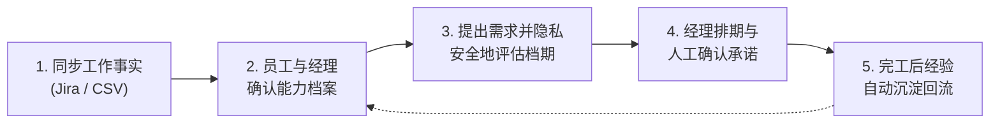

<h1 align="center">知程（OrgPace）</h1>

<p align="center">
  <strong>以真实员工能力画像与实时资源负载为底座，自动排期项目、理顺人员与部门间的卡点，推进项目快速进展。</strong><br />
  可自托管的项目排期与跨部门交付推进引擎，让能力事实与实时余量真正驱动项目落地。
</p>

<p align="center">
  <a href="#产品界面">产品界面</a> ·
  <a href="#使用流程">使用流程</a> ·
  <a href="#功能路线图">功能路线图</a> ·
  <a href="#快速开始">快速开始</a> ·
  <a href="docs/README.md">文档索引</a> ·
  <a href="README.md">English</a>
</p>

<p align="center">
  <a href="LICENSE"></a>
  
  
</p>

## 为什么做知程

项目推进之所以总卡住，往往不是团队不够努力，而是跨部门要不到合适的人、关键骨干长期隐性过载、排期只能靠表格拍脑袋。**知程**以「真实能力画像 + 70%/30% 实时资源负载」为可信底座，帮你理顺人员与部门间的协同卡点，让排期真正落得下去，推进项目快速交付。

| 场景 | 传统方式 | 知程 |
| :--- | :--- | :--- |
| **能力底座** | 靠印象、口头打听或过时 HR 表格 | 从 Jira 或导入的 CSV 工作记录整理能力草稿，经员工自查与经理审批后生效 |
| **负载与余量** | 静态 Excel 假设全员 100% 可用，骨干隐性超载 | 区分 70% 常规配额与 30% 弹性缓冲空间，结合趋势与业务波动预测未来可用余量 |
| **跨部门卡点** | 群里反复协调要人，或被迫公开个人日程隐私 | 需求方仅查看能否承接及最早启动时间，**不暴露个人明细**；资源方经理私下调整分工 |
| **排期落地** | 靠口头拍板，或 AI 助手未经校验擅自答应 | 经过规则校验的排期卡片，必须由负责人人工点击确认后才正式生效 |

**知程的日常协同闭环：**

1. **用真实工作记录夯实能力与负载底座：** 同步 Jira 或导入 CSV 工作记录生成能力草稿，由员工本人核对补充、经理审核确认，告别靠印象找人。
2. **隐私安全地打通跨部门档期卡点：** 需求方说明业务目标、所需能力与期望时间窗，即可得知目标部门能否承接以及最早何时可以启动，不暴露对方团队个人负荷明细。
3. **在真实余量内排期并人工确认承诺：** 目标部门经理参考 70%/30% 配额与远期预测余量，避免骨干隐性过载，在卡片界面精细调整分工并通过网页或飞书确认生效。
4. **交付完成后经验自动回流：** 项目或任务完成后，经理记录事实性反馈，经员工过目确认后补充进能力档案，让后续排期与用人越用越准。

## 产品界面

以下为基于 100% 合成演示数据（`Acme Engineering`）截取的 1440×900 英文桌面界面：

<table>
  <tr>
    <td width="50%" align="center">
      <a href="docs/assets/readme/03-my-profile-en.png"></a><br />
      <sub><strong>能力底座（My Profile）</strong> — 查看已确认和待审核的能力判断与事实依据，未涉及的领域保持未知。</sub>
    </td>
    <td width="50%" align="center">
      <a href="docs/assets/readme/05-capacity-workload-en.png"></a><br />
      <sub><strong>团队负荷与余量（Team Workload）</strong> — 直观查看每周投入、70% 常规配额、远期余量预测与波动策略。</sub>
    </td>
  </tr>
  <tr>
    <td width="50%" align="center">
      <a href="docs/assets/readme/04-reviews-en.png"></a><br />
      <sub><strong>待审批中心（Reviews）</strong> — 在同一队列处理画像变更、负荷调整与协同需求，支持按组织层级自动代审。</sub>
    </td>
    <td width="50%" align="center">
      <a href="docs/assets/readme/07-assistant-en.png"></a><br />
      <sub><strong>工作助手（Work Assistant）</strong> — 在本人权限范围内用中文或英文查询团队承接力、起草申请或准备排期。</sub>
    </td>
  </tr>
</table>

## 使用流程



1. **同步工作事实：** 接入 Jira Cloud/Data Center 或导入 CSV 工作记录，自动整理成员能力草稿。
2. **员工与经理确认能力档案：** 员工本人自查补充后提交，由经理（支持按组织层级自动代理）审核确认生效。
3. **提出需求并隐私安全地评估档期：** 需求方发起单部门或多角色项目需求，了解各目标部门能否承接与最早启动时间，不窥探个人日程。
4. **经理排期与人工确认承诺：** 目标部门经理结合每周可用余量与预测趋势在卡片中安排分工，通过网页或飞书确认卡由人确认生效。
5. **完工后经验自动沉淀：** 项目或任务完成后，经理填写事实性交付反馈，经员工确认后回流补充能力档案。

## 功能路线图

我们严格区分「现已可用」与「后续功能规划」，只介绍真实可落地的产品能力。

| 功能板块 | 状态 | 用户价值与核心能力 |
| :--- | :---: | :--- |
| **团队能力档案** | ✅ **现已可用** | 从 Jira/CSV 同步工作记录、员工自查补充、经理（含组织代理）审批确认 |
| **负荷与远期预测** | ✅ **现已可用** | 周可用投入与不可用时段、70% 常规 + 30% 弹性配额及未来余量预测 |
| **跨部门隐私排期** | ✅ **现已可用** | 需求方只看能否承接与最早启动时间，经理卡片化排期并人工确认生效 |
| **多角色项目与回流** | ✅ **现已可用** | 支持多角色分阶段项目跟进，完工后事实反馈自动沉淀为个人能力档案 |
| **双语与日常入口** | ✅ **现已可用** | 全站一键切换中英文，提供内置助手与飞书交互确认卡片 |
| **全自动项目排期** | 🚧 **后续规划** | 结合项目目标、任务依赖与实时负载自动生成无冲突排期并交由人工确认 |
| **按目标跨边界组队** | 🚧 **后续规划** | 直接从业务目标出发发现跨团队合适人选，并按成员归属自动衔接审批 |
| **因人拆解与老带新** | 🚧 **后续规划** | 结合成员复合特长拆解任务，骨干满载时推荐「专家把关 + 新人主力执行」 |
| **全局排期与卡点视图** | 🚧 **后续规划** | 统一协作时间表、人员/部门卡点洞察与前置/协作/冲突合一风险视图 |
| **变化影响与轻量重排** | 🚧 **后续规划** | 突发请假、前置延期或需求变更时快速评估影响并给出最小扰动重排建议 |
| **更多生态与生产就绪** | 🚧 **后续规划** | 拓展 Slack / Microsoft Teams 等办公工具，完善生产 HTTPS 部署指引 |

### ✅ 现已可用（Available Now）

- **可信的团队能力档案：** 自动从 Jira 或导入的工作记录中整理成员能力草稿，经员工自查与经理（支持按组织层级自动代理）审核确认后生效；只记录可追溯的工作事实，未知即未知。
- **团队负荷透明化与远期余量预测：** 成员自主维护每周可用投入与不可用时段；知程区分常规工作配额（70%）与弹性缓冲空间（30%），并结合延续趋势与业务波动预测未来数周的真实可用余量。
- **隐私友好的跨部门档期评估与可视化排期：** 跨部门发起需求时，需求方只需说明目标与时间，即可得知能否承接及最早启动时间，不暴露他部门个人明细；资源方经理可在卡片化界面精细调整分工并人工确认生效，避免 AI 或口头擅自承诺。
- **多角色分阶段项目与实战经验回流：** 支持多角色、分阶段的复杂项目排期与执行跟进；工作完成后，实际交付成果可回流补充成员能力档案。
- **全站中英双语与多入口协同：** 网页端一键中英切换并记住偏好，内置对话助手与飞书交互确认卡片，日常更新与审批开箱即用。

### 🚧 后续功能规划（Coming Next）

- **全自动项目排期：** 基于项目目标、阶段依赖关系与团队实时负载自动生成可执行、无冲突的项目排期方案，经负责人确认后生效。
- **按业务目标跨边界组队：** 发起任务不再必须预设具体部门或固定岗位，系统可根据权限策略在更广范围内发现合适人选，并按所选成员归属自动衔接审批流程。
- **因人拆解任务与老带新协作：** 结合现有成员的复合特长给出更合理的任务拆分建议；当资深骨干满载、新人有余量时，自动推荐「骨干少量精力负责方案与把关 + 新人主力执行」的结对协作方式，并在完工后帮助新人沉淀能力证明。
- **全局协作排期与人员/部门卡点风险视图：** 提供跨项目协作时间表、人员与部门级能力瓶颈/闲置专长洞察，以及把「前置交付阻塞、人员协作等待、同人档期冲突」合一呈现的关键风险视图。
- **突发变化影响评估与轻量重排：** 当成员临时请假、前置工作延期或需求调整时，快速识别受影响的交付日期与阻塞环节，给出扰动最小的调整建议并交由负责人确认。
- **更多办公生态接入与生产就绪：** 扩展更多企业通讯工具（如 Slack、Microsoft Teams），完善生产环境 HTTPS 部署指引与开源合规核验。

## 快速开始

> [!CAUTION]
> **仅限本地评估体验：** 默认 `.env.example` 运行在开发模式，包含示例密钥（`changethis`）与合成演示账号。正式部署或暴露公网前，请使用 `./install.sh` 并遵循[生产部署指南](docs/deploy.md)。

**环境前提：** 已安装 Docker 与 Docker Compose（`>= 2.24.4`）。

```bash
git clone https://github.com/GSX-Eis/OrgPace.git
cd OrgPace
cp .env.example .env
docker compose up -d --wait
```

待各服务就绪后，在浏览器打开 **<http://localhost:8000>**（可随时点击右上角 `中文 / EN` 一键切换界面语言）。日常停止可执行 `docker compose down` 保留数据；如需清空本地演示库，可执行 `docker compose down -v`。

<details>
<summary>合成演示账号（使用 <code>.env.example</code> 启动时自动导入，不含真实员工数据）</summary>

`examples/demo-org/` 中的企业、成员与任务记录均为 100% 合成数据：

| 身份 | 邮箱 | 密码 |
| :--- | :--- | :--- |
| **企业管理员** | `admin@demo.example.com` | `demo-password-2026` |
| **部门经理（`E01`）** | `manager.platform@demo.example.com` | `demo-password-2026` |
| **普通员工（`E02`）** | `employee.platform@demo.example.com` | `demo-password-2026` |
| **平台超管** | `admin@example.com` | `changethis` |

</details>

## 我们不做什么

- **不做员工监控：** 不追踪键盘、屏幕、工时或代码提交数；缺少记录不代表员工不会，成员自主维护不可用时段。
- **不允许 AI 擅自做承诺：** 所有排期与能力档案生效都必须经过明确的规则校验与人工确认，AI 助手只提供建议与草稿。
- **不是传统财务或进销存 ERP：** 不做总账、薪酬或供应链管理，知程专注以真实能力与资源负载驱动跨团队交付协同。

## 文档与许可证

- **使用与部署文档：** [文档索引](docs/README.md) · [生产部署指南](docs/deploy.md) · [Docker Compose 快速说明](docs/deployment-docker-compose.md) · [管理员指南](docs/admin-guide.md) · [经理指南](docs/manager-guide.md) · [员工指南](docs/employee-guide.md) · [扩展开发指南](docs/extending.md)
- **许可证与贡献：** 本项目按 [Apache License 2.0](LICENSE) 开源（见 [NOTICE](NOTICE)），并保留上游 [MIT 许可证说明](licenses/full-stack-fastapi-template-MIT.txt)。第三方依赖核验与再分发说明见[依赖许可证核验](docs/licenses.md)，欢迎通过 [CONTRIBUTING.md](CONTRIBUTING.md) 参与贡献。
