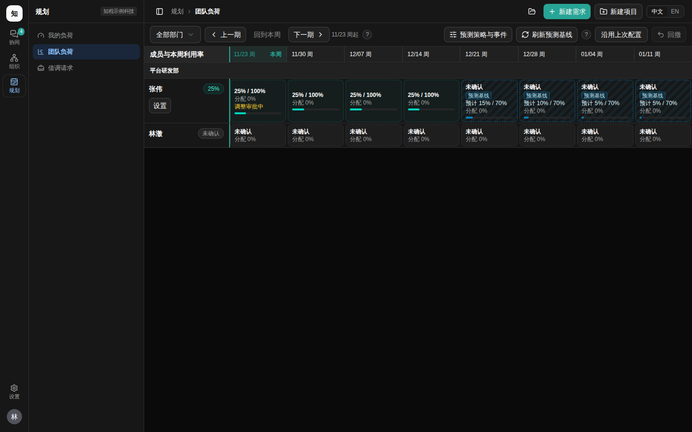
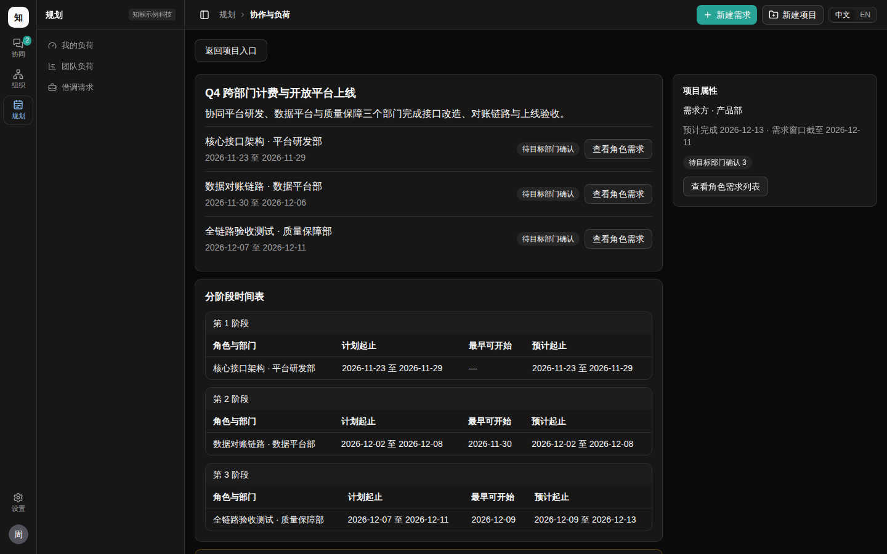
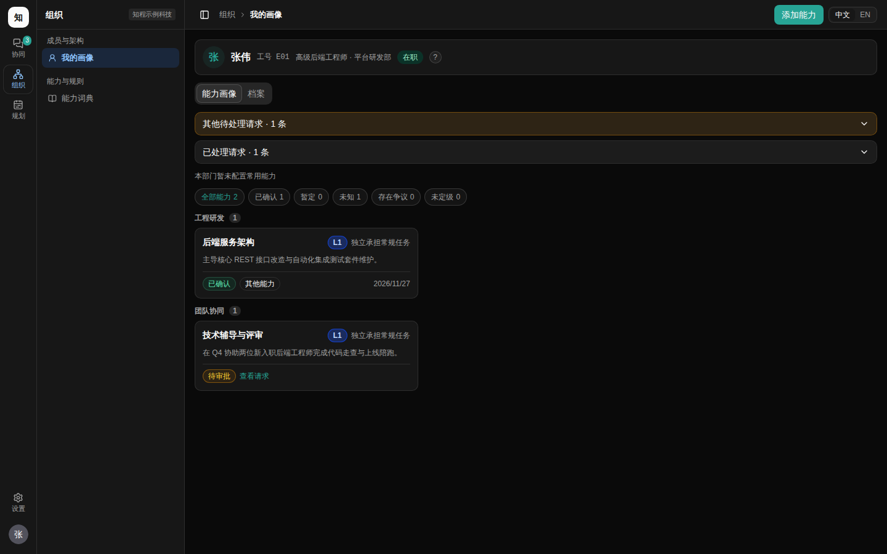
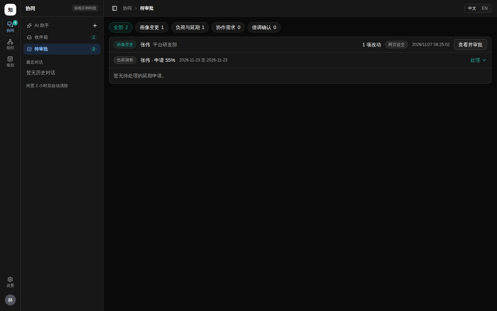
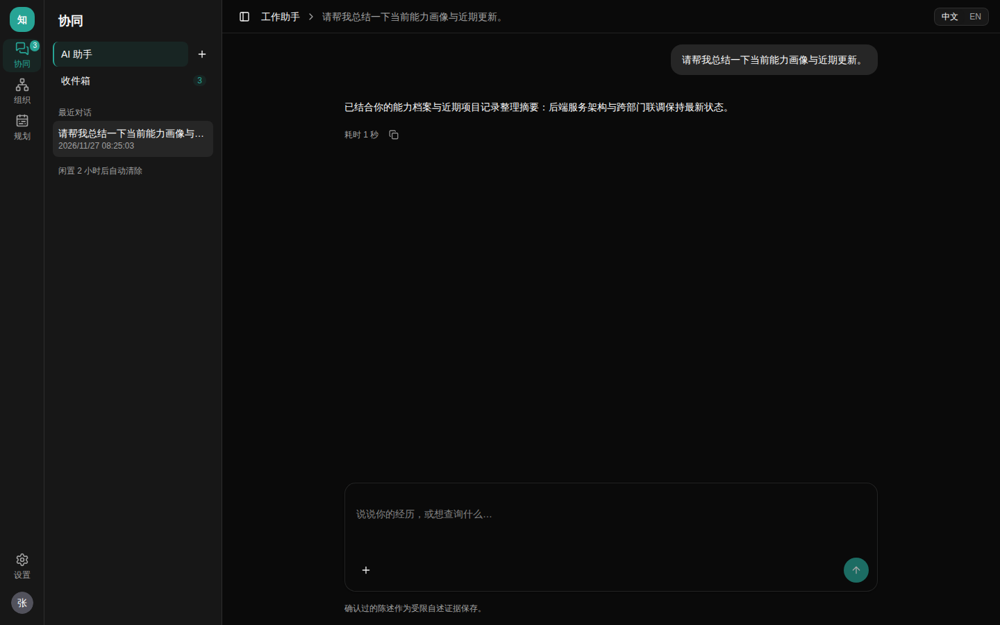
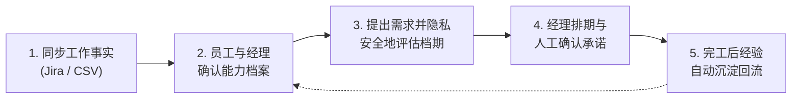

<p align="center">
  <picture>
    <source media="(prefers-color-scheme: dark)" srcset="docs/assets/readme/orgpace-logo-dark.svg" />
    <source media="(prefers-color-scheme: light)" srcset="docs/assets/readme/orgpace-logo-light.svg" />
    
  </picture>
</p>

<h1 align="center">知程（OrgPace）</h1>

<p align="center">
  <strong>以真实员工能力画像与实时资源负载为底座，自动排期项目、理顺人员与部门间的卡点，推进项目快速进展。</strong><br />
  可自托管的项目排期与跨部门交付推进引擎，让能力事实与实时余量真正驱动项目落地。
</p>

<p align="center">
  <a href="#产品界面">产品界面</a> ·
  <a href="#使用流程">使用流程</a> ·
  <a href="#集成与模型支持">集成与模型</a> ·
  <a href="#功能路线图">功能路线图</a> ·
  <a href="#快速开始">快速开始</a> ·
  <a href="docs/README.md">文档索引</a> ·
  <a href="#社区与贡献">社区与贡献</a> ·
  <a href="README.md">English</a>
</p>

<p align="center">
  <a href="https://github.com/GSX-Eis/OrgPace/releases"></a>
  <a href="https://github.com/GSX-Eis/OrgPace/actions/workflows/test-backend.yml"></a>
  <a href="https://github.com/GSX-Eis/OrgPace/actions/workflows/test-docker-compose.yml"></a>
  <a href="https://github.com/GSX-Eis/OrgPace/commits/master"></a>
  <a href="LICENSE"></a>
  
  
</p>

<p align="center">
  <a href="docs/assets/readme/05-capacity-workload-zh.png">
    
  </a>
  <br />
  <sub><strong>实时团队负荷与远期余量预测</strong> — 直观查看每周投入、弹性负载缓冲与未来可用余量预测基线（1440×900 合成演示数据：<code>知程示例科技</code>）。</sub>
</p>

## 为什么做知程

项目推进之所以总卡住，往往不是团队不够努力，而是跨部门要不到合适的人、关键骨干长期隐性过载、排期只能靠表格拍脑袋。**知程**以「真实能力画像 + 弹性资源负载」为可信底座，帮你理顺人员与部门间的协同卡点，让排期真正落得下去，推进项目快速交付。

| 场景 | 传统方式 | 知程 |
| :--- | :--- | :--- |
| **能力底座** | 靠印象、口头打听或过时 HR 表格 | 从 Jira 或导入的 CSV 工作记录整理能力草稿，经员工自查与经理审批后生效 |
| **负载与余量** | 静态 Excel 假设全员 100% 可用，骨干隐性超载 | 内置常规与弹性负载缓冲，结合趋势与业务波动预测未来可用余量 |
| **跨部门卡点** | 群里反复协调要人，或被迫公开个人日程隐私 | 需求方仅查看能否承接及最早启动时间，**不暴露个人明细**；资源方经理私下调整分工 |
| **排期落地** | 靠口头拍板，或 AI 助手未经校验擅自答应 | 经过规则校验的排期卡片，必须由负责人人工点击确认后才正式生效 |

## 产品界面

以下为基于 100% 合成演示数据（`知程示例科技`）截取的 1440×900 简体中文桌面界面（系统支持全站一键切换英文界面）：

<table>
  <tr>
    <td width="50%" align="center">
      <a href="docs/assets/readme/08-cross-team-project-zh.png"></a><br />
      <sub><strong>跨部门多角色项目排期</strong> — 统筹多部门分阶段角色需求、前置依赖、最早启动时间与排程延期影响提示。</sub>
    </td>
    <td width="50%" align="center">
      <a href="docs/assets/readme/03-my-profile-zh.png"></a><br />
      <sub><strong>能力底座（我的画像）</strong> — 查看已确认和待审核的能力判断与事实依据，未涉及的领域保持未知。</sub>
    </td>
  </tr>
  <tr>
    <td width="50%" align="center">
      <a href="docs/assets/readme/04-reviews-zh.png"></a><br />
      <sub><strong>待审批中心（Reviews）</strong> — 在同一队列处理画像变更、负荷调整与协同需求，支持按组织层级自动代审。</sub>
    </td>
    <td width="50%" align="center">
      <a href="docs/assets/readme/07-assistant-zh.png"></a><br />
      <sub><strong>工作助手（Work Assistant）</strong> — 在本人权限范围内用中文或英文查询团队承接力、起草申请或准备排期。</sub>
    </td>
  </tr>
</table>

## 使用流程



1. **同步工作事实：** 接入 Jira Cloud/Data Center 或导入 CSV/XLSX 工作记录，基于真实贡献生成能力草稿，告别靠印象找人。
2. **员工与经理确认能力档案：** 员工本人自查补充后提交，由经理（支持按组织层级自动代理）审核确认生效。
3. **提出需求并隐私安全地评估档期：** 需求方说明业务目标、所需能力与期望时间窗，即可了解目标部门能否承接与最早启动时间，不暴露对方团队个人日程明细。
4. **经理排期与人工确认承诺：** 目标部门经理结合每周弹性负载与远期预测余量在卡片中安排分工，通过网页或飞书确认卡由人工确认生效，避免骨干隐性过载。
5. **完工后经验自动沉淀：** 项目或任务完成后，经理填写事实性交付反馈，经员工确认后自动回流补充能力档案，让后续排期与用人越用越准。

## 集成与模型支持

> [!NOTE]
> **本地体验演示数据无需预先配置 API Key。** 不配置任何大模型时，网页端的员工能力画像、审批流、团队负荷预测、跨部门档期评估与项目排期等核心功能均可直接体验；仅在启用「AI 自动起草」或「工作助手对话」时，才需要管理员在网页端「管理 → 模型」设置页填写模型凭据。

| 类别 | 支持范围 | 状态与说明 |
| :--- | :--- | :--- |
| **数据源** | **Jira Cloud**（API Token）、**Jira Data Center**（PAT / 账号密码）、**CSV / XLSX** 工作记录与花名册导入 | ✅ **现已可用** — 支持定时增量同步与手工导入，缺失记录保持未知 |
| **协同入口** | **Web 工作台**（EN / 简体中文）、**飞书**（出站长连接 + 交互确认卡）、**企业微信**（出站长连接 + 私聊助手与审批提醒） | ✅ **现已可用** — 均无需公网入站回调；IM 适配在 CI 中经模拟服务验证，生产环境填入企业自建应用凭据即可 |
| **规划中入口** | **Slack**、**Microsoft Teams** | 🚧 **后续规划** |
| **AI 模型提供方（云端 API）** | **OpenAI**、**Anthropic Claude**（API Key）、**DeepSeek**、**通义千问 / 阿里云百炼**（中国/新加坡/美国区）、**Moonshot / Kimi**（国际版、中国版、Kimi Coding）、**OpenRouter** | ✅ **现已可用** — 按企业在网页端配置，密钥加密存储 |
| **本地 / 兼容 / 订阅模型** | **Ollama**（本地或自建服务）、**OpenAI 兼容服务**（自定义 `http`/`https` 接口地址）、**ChatGPT 订阅**（OAuth 登录） | ✅ **现已可用** — 按需开启，未开启时不影响核心排期与画像功能 |

## 功能路线图

我们严格区分「现已可用」与「后续功能规划」，只介绍真实可落地的产品能力：

| 功能板块 | 状态 | 用户价值与核心能力 |
| :--- | :---: | :--- |
| **可信团队能力档案** | ✅ **现已可用** | 从 Jira/CSV 同步工作记录自动起草，经员工自查与经理（含组织代理）审批生效；只记录可追溯工作事实 |
| **负荷透明化与远期预测** | ✅ **现已可用** | 成员自主维护可用投入与不可用时段，内置弹性负载缓冲防止过载，并预测未来数周可用余量 |
| **跨部门隐私排期与确认** | ✅ **现已可用** | 需求方只看能否承接与最早启动时间，不暴露个人明细；经理卡片化排期并人工点击确认生效 |
| **多角色项目与经验回流** | ✅ **现已可用** | 支持多角色分阶段项目与前置依赖跟进，完工后事实反馈自动回流沉淀为成员能力档案 |
| **全站双语与多入口协同** | ✅ **现已可用** | 网页端一键切换中英文并记住偏好，提供内置对话助手及飞书、企业微信通道接入 |
| **全自动项目排期** | 🚧 **后续规划** | 基于项目目标、阶段依赖与团队实时负载自动生成可执行、无冲突排期方案并交由人工确认 |
| **按业务目标跨边界组队** | 🚧 **后续规划** | 从业务目标出发在授权范围内跨团队发现合适人选，并按所选成员归属自动衔接审批流程 |
| **因人拆解任务与老带新** | 🚧 **后续规划** | 结合成员复合特长拆解任务；资深骨干满载时推荐「专家把关 + 新人主力执行」结对并沉淀证明 |
| **全局排期、卡点与风险视图** | 🚧 **后续规划** | 跨项目协作时间表、人员/部门能力瓶颈洞察，以及前置阻塞/协作等待/冲突合一的关键风险视图 |
| **突发变化影响与轻量重排** | 🚧 **后续规划** | 临时请假、前置延期或需求变更时快速评估交付影响，给出最小扰动调整建议交由负责人确认 |
| **更多办公生态与生产就绪** | 🚧 **后续规划** | 扩展 Slack / Microsoft Teams 等办公工具集成，完善生产 HTTPS 指引与二进制分发合规核验 |

## 快速开始

> [!CAUTION]
> **仅限本地评估体验：** 默认 `.env.example` 运行在开发模式，包含示例密钥（`changethis`）与合成演示账号。正式部署或暴露公网前，请使用 `./install.sh` 并遵循[生产部署指南](docs/deploy.md)。

**环境前提：** 已安装 Docker 与 Docker Compose（`>= 2.24.4`）。建议至少预留 **20 GiB** 可用磁盘空间（低于 15 GiB 请勿构建）。首次执行 `docker compose up -d --wait` 需要拉取基础镜像并编译前后端依赖，通常耗时 **3–8 分钟**；后续启动可在数秒内完成。

```bash
git clone https://github.com/GSX-Eis/OrgPace.git
cd OrgPace
cp .env.example .env
docker compose up -d --wait
```

待各服务就绪后，在浏览器打开 **<http://localhost:8000>**（可随时点击右上角 `中文 / EN` 一键切换界面语言）。日常停止可执行 `docker compose down` 保留数据；如需清空本地演示库，可执行 `docker compose down -v`。

<details>
<summary>合成演示账号（使用 <code>.env.example</code> 启动时自动导入，不含真实员工数据）</summary>

> **演示数据预期说明：** 使用默认 `.env.example` 启动时，系统会自动导入内置的**基础中文合成示例企业**（`examples/demo-org/`，包含 4 个部门、12 名合成员工与 12 项研发能力），用于快速体验能力画像与基础协同流程，与上方全场景功能展示截图（`知程示例科技` / `Acme Engineering`）中的数据不同。

`examples/demo-org/` 中的企业、成员与任务记录均为 100% 合成数据：

| 身份 | 邮箱 | 密码 |
| :--- | :--- | :--- |
| **企业管理员** | `admin@demo.example.com` | `demo-password-2026` |
| **部门经理（`E01`）** | `manager.platform@demo.example.com` | `demo-password-2026` |
| **普通员工（`E02`）** | `employee.platform@demo.example.com` | `demo-password-2026` |
| **平台超管** | `admin@example.com` | `changethis` |

</details>

## 我们不做什么

- **不做员工监控：** 不追踪键盘、屏幕、工时或代码提交数；缺少记录不代表员工不会，成员自主维护不可用时段。
- **不允许 AI 擅自做承诺：** 所有排期与能力档案生效都必须经过明确的规则校验与人工确认，AI 助手只提供建议与草稿。
- **不是传统财务或进销存 ERP：** 不做总账、薪酬或供应链管理，知程专注以真实能力与资源负载驱动跨团队交付协同。

## 文档与许可证

- **使用与部署文档：** [文档索引](docs/README.md) · [English Docs Index](docs/README_EN.md) · [生产部署指南](docs/deploy.md) · [Docker Compose 快速说明](docs/deployment-docker-compose.md) · [管理员指南](docs/admin-guide.md) · [经理指南](docs/manager-guide.md) · [员工指南](docs/employee-guide.md) · [扩展开发指南](docs/extending.md)
- **许可证：** 本项目按 [Apache License 2.0](LICENSE) 开源（见 [NOTICE](NOTICE)），并保留上游 [MIT 许可证说明](licenses/full-stack-fastapi-template-MIT.txt)。第三方依赖核验与再分发说明见[依赖许可证核验](docs/licenses.md)。

## 社区与贡献

- **讨论与问答：** 部署咨询、场景交流与功能探讨请前往 [GitHub Discussions](https://github.com/GSX-Eis/OrgPace/discussions)。
- **缺陷反馈与需求建议：** 通过 [Issue 模板](https://github.com/GSX-Eis/OrgPace/issues/new/choose) 提交结构化反馈。
- **版本发布：** 在 [GitHub Releases](https://github.com/GSX-Eis/OrgPace/releases) 查看历史版本与变更说明。
- **参与贡献：** 提交代码或文档前请阅读 [CONTRIBUTING.md](CONTRIBUTING.md) 与 [行为准则](CODE_OF_CONDUCT.md)。
- **安全披露：** 如发现安全漏洞，请按 [SECURITY.md](SECURITY.md) 指引通过私密通道报告，勿在公开 Issue 中披露。
