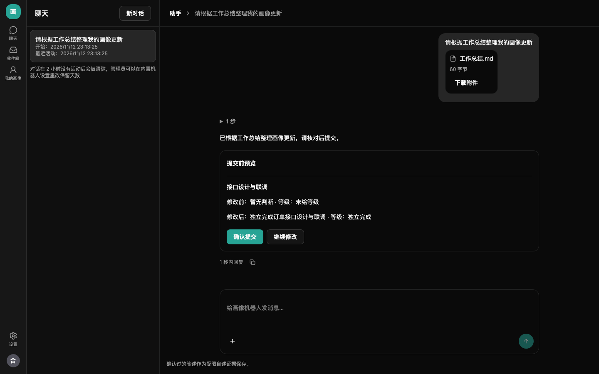
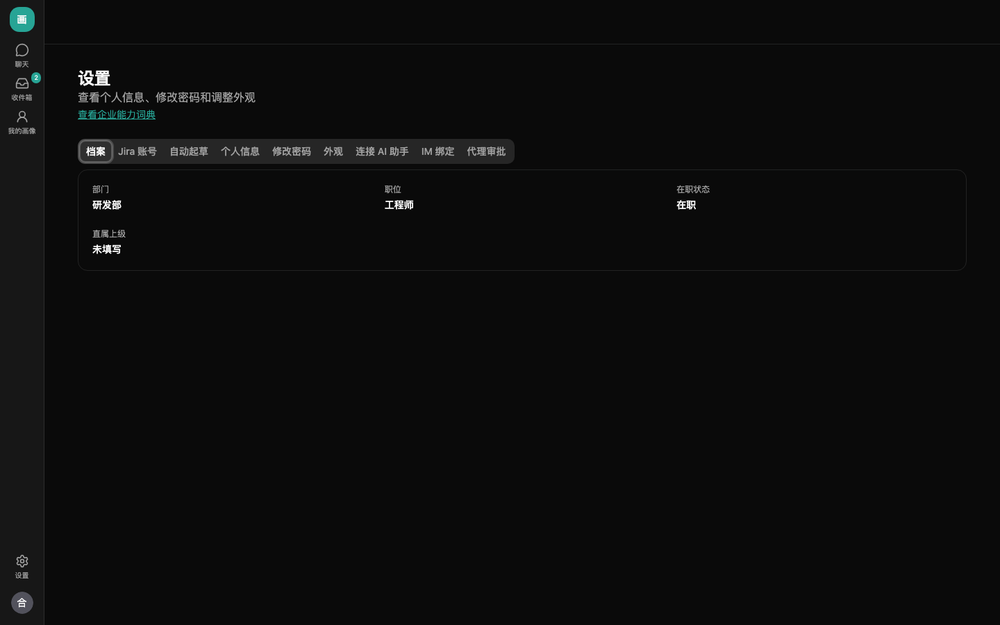
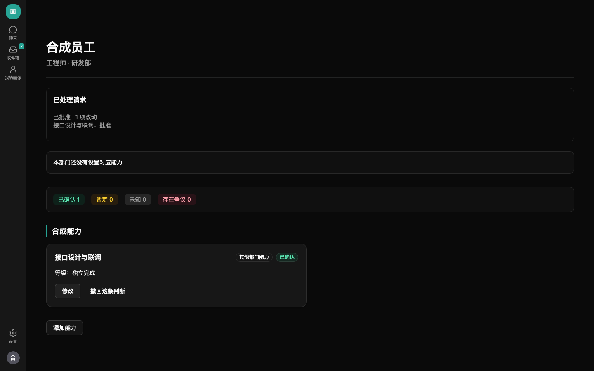

# 员工使用指南

文字已按 M6 更新；截图保留 M4.3 的界面，操作以文字说明为准。

## M4：查看审批结果、修改与重提

提交后在收件箱和本人画像的请求卡片查看审批结果。部分批准的项立即发布，其他项不会一起生效；混合结果按逐项决定汇总，例如「1 项批准、2 项被拒绝」，展开可看每项结果。精简后的画像页不再展示请求时间线和版本历史。

被拒绝的请求和被拒改动项会以红色卡片或红色高亮块醒目展示经理的拒绝原因，并自动生成关联重提草稿。平台已取消被拒申诉流程：如需修改，在「已处理请求」点击「修改重提」（或到「其他待处理请求」打开草稿点「继续修改」），补充依据后先预览再提交；原请求及拒绝原因保留。系统升级前遗留的历史申诉记录仅作只读展示，管理员维持原决定或允许重新提交后在原项查看历史结果说明。

经理本人也只能提交自己的更新，不能批准自己的请求。只有 Jira 来源支持的判断即使批准也最多是「暂定」。企业关闭经理确认的能力类别在你确认后直接发布为暂定。

正式画像也可以由企业管理员或管辖经理直接修改，改后通知本人（E21）；他们不能直接修改自己的画像。系统自动起草仍先交本人过目。直接修改的通知和异议处理见下文。

## 谁能看到我的画像

| 内容 | 谁能看到 |
| --- | --- |
| 正式画像的能力、等级、状态和陈述 | 本人、管辖经理（包括获授权的上级部门经理）、企业管理员 |
| 依据说明和受限自述正文 | 本人和管辖经理；经理在网页审批页查看，助手工具不提供下属这些正文和来源 |
| 请求中未发布的陈述（含待本人过目、待审、退回等） | 本人、管辖经理；当前实际审批人及有效代理在待审批期间可读该请求 |

管辖范围包含获授权部门及其全部下级部门。管理员身份本身不授予受限正文权限，兼任本人或管辖经理时按相应身份授权。查看画像或自述不通知本人，也不留应用内查看记录；直接修改发布后会通知本人。画像页和填写表单的「谁能看到」可展开查看同样说明。

上述常规可见范围适用于在职员工。管理员不是当前实际审批人、也没有本人或管辖经理身份时，未发布的陈述显示「未发布的陈述仅本人、管辖经理和审批人可见」。部分批准请求中，已批准项的陈述可见，退回或其他未批准项仍按此限制；草稿仍由本人编辑、提交。

离职后画像和自述归档只读，只有企业管理员可查看归档的能力、等级和状态；受限自述和经理评价正文不显示，管理员兼任部门经理也不能看。本人、经理及其他人均不能再查看离职员工画像，团队、助手、飞书和 MCP 也不再提供这些内容。账号停用，未处理的请求自动撤回；恢复在职后按在职规则可见，撤回的请求不会自动恢复。

数据保存在本企业自己部署的服务器上；存放位置、备份和保留期限请问企业管理员。

审批时还有临时读取例外：当前请求的获授权审批人（含代理人、兜底管理员）在待审批期间可以读取该请求引用的受限内容；处理完毕或代理失效后恢复原权限，不扩展到其他请求或整个部门。

## 助手、我的画像和设置

用管理员提供的员工邮箱登录，首次登录按提示修改密码。登录后进入「助手」：最左侧是图标导航栏，中间是历史对话，右侧是对话区。员工有「聊天」「收件箱」「我的画像」和底部「设置」；经理还会看到「待审批」「我的团队」「组织架构」。手机上点「会话」切换历史对话或新建对话。

回复逐段显示，工具调用过程可展开，点「停止」取消当前轮。未配置模型、额度不足或服务暂时不可用时，按会话区的提示处理；「我的画像」和设置仍可使用。每人每小时最多三十轮，ChatGPT 订阅的企业共用该账号额度，起草任务优先。画像用于协作找人，不用于绩效、薪酬和晋升。

处理超过三分钟会明确提示超时和分批办法，可缩小本次要处理的材料范围后继续；冷却和额度恢复提示使用北京时间及预计等待分钟数。需要退出时，点导航底部直接可见的「退出登录」（手机先展开菜单），回到登录页会显示「已退出」。关标签页不等于退出。

「设置」中有档案、Jira 账号、自动起草、个人信息、修改密码、外观、IM 绑定、外部身份和代理审批。档案展示工号、部门、职位、上级以及企业开启的工作属性；画像页标题也显示工号，同名时可据此核对。Jira 账号查看已关联身份；自动起草可由本人退出或恢复；外部 AI 助手连接与令牌入口已自 E53 起默认下线，设置顶部可查看企业能力词典。档案与账号信息不再放在画像详情中。

直属上级不一定是部门经理。例如值班经理没有部门经理授权时，下属请求交给本部门或上级部门经理，都没有时由企业管理员审批。到「设置 → 个人信息」可核对直属下属姓名、工号和当前审批人（含有效代理）；没有可用审批人时页面会说明。你不是该下属审批人时，会显示「你没有团队查看和审批权限，需要的话请找企业管理员」。已有审批权的下属不显示这段提示；直属上级关系本身不授予团队查看或审批权，助手和飞书采用相同说明。

### 切换界面语言

平台默认使用中文界面（`zh-CN`），支持在登录页和主界面顶栏右侧点击 `中文 / EN` 一键切换，无需进入二级设置菜单：

- **即时生效与本地记忆**：切换后立即生效并保存在当前浏览器的本地缓存中；刷新页面或退出回到登录页后仍保持所选语言，不会先闪出中文。
- **跨设备同步**：已登录状态下切换语言会同步保存到你的账号偏好，更换浏览器或设备重新登录后自动恢复。
- **双语覆盖范围**：网页界面、校验提示与后端报错、新产生的站内通知（历史通知若无英文仍显示中文）、IM 推送以及内置助手回复均跟随当前语言。员工姓名、部门名称、能力词典条目、工作记录标题与证据原文等业务数据保持原文展示。

## 需求与容量

企业管理员开启后，导航出现「需求与容量」（`/capacity`）。你可以查看「我的负荷」「我的分配」「待我审批」；企业允许全体员工提需求时，还会有「我提的需求」。没有入口时先请管理员核对开关和本人账号。关闭模块只隐藏入口并停止该模块操作，记录保留，画像功能不受影响。

### 我的负荷：按周查看与申请调整

进入「需求与容量 → 我的负荷」，先看 Jira 参考值和本周经理确认值，再看「每周投入」的 8 张周卡。Jira 参考值是已同步、未完成且当前指派给你的任务**件数**；未接入或未关联账号显示「无」，不是零。件数不换算成百分比，也不能表示难度或工时。周卡按周一开始的自然周显示占用 / 可用：占用是该周平台外其他工作占比加与该周重叠的进行中分配；可用按当周周一至周五未被不可用日期覆盖的工作日计算。即使只重叠一天，分配投入也按整周计。负荷不是绩效，不打分、不排名。

没有该周记录显示「未确认」，不等于有空；确认超过 28 天显示「需重新确认」。有申请待审显示「修正待审」，不可用日期扣减后显示「可用 X%」，旧分配可能显示「开始日期未确认」。本周确认值低于可用比例的 80% 为「有余量」，不超过可用为「基本满」，超过可用为「超负荷」；未确认不会显示有余量。需要承诺新分配时，未确认、需重新确认或超额的当前及未来周会被拦下，请经理先确认或调整安排。

认为平台外工作占比不符时：

1. 在「申请调整」选择「开始周」「结束周」（均为周一，范围 1–26 周，结束周不能早于本周），填「申请负荷（%）」（0–200 整数）和「申请原因」（1–500 字）。只填平台外其他工作占比，平台内分配另行计入；例如其他工作 40% 加平台分配 30%，占用为 70%。
2. 表单会显示「将交给」的审批人；点「提交申请」后，结果也会显示交给谁审批。等当前有权审批人处理；同一时间最多一条待处理申请。申请不会立即修改确认值。
3. 在「调整申请记录」看周范围、结果与处理说明；升级前无周范围的旧申请显示「批准当周」。退回后可重新申请。经理直接设置周投入后也会通知本人，经理不能直接设置自己的周投入。

网页或飞书助手可说：「请申请把我从下周起的四周平台外工作占比改为 60%，原因是……」。核对「申请调整负荷」卡后点「确认」才提交，模型不会替你批准。

### 我的不可用日期

在「我的负荷 → 我的不可用日期」填写「开始日期」「结束日期」（最多 92 天，不填原因），点「登记」。仅本人登记的条目可由本人点「删除」；经理代登记的条目需请有权经理处理。登记会扣减相应周的可用比例；如已有分配超出可用，页面会提示沟通处理，已有分配不会自动调整。

不可用日期与进行中的分配重叠时，承接部门经理也会收到影响提醒。若需变更安排，请与经理沟通，并在「我的分配」查看正式结果。

### 我的分配：查看工作和申请延期

进入「需求与容量 → 我的分配」，每条显示能力、需求方部门、投入比例、「开始：日期」或「开始日期未确认」、预计完成日期、说明及「进行中／已完成／已取消」状态。分配由承接部门有权人员安排，通知从收件箱进入；进行中的投入按覆盖的周计入负荷，完成或取消后不再计入。完成不会自动修改画像。

1. 干不完时，在进行中的分配下填写「申请完成日期」和「延期原因」（1–500 字）。新日期须晚于当前预计完成日期。
2. 表单显示「将交给」的审批人姓名，点「提交延期申请」后等待审批；同一分配已有待处理延期时不能重复提交。若提示没有能审批的经理，联系企业管理员核对授权。
3. 在「延期申请记录」查看结果和处理说明。退回不改日期；同意时系统会校验从开始周与本周较晚者到新结束周的容量，过去周不再校验。若有未确认、需重新确认或超额周，审批会被拦下，需请经理先确认周投入或调整安排。经理直接改日期也受同一校验，并会通知你。

也可在网页或飞书助手说：「把分给我的这项工作申请延到某月某日，原因是……」，核对「申请延期」卡后点「确认」。只能申请自己的分配，不能替别人申请或批准自己。

负荷调整和延期的审批人（含普通员工代理、兜底管理员）在「需求与容量 → 待我审批」处理。延期审批人和代理人还须是目标部门 B 及下级的在职成员，或 B 的有权代表；跨部门代理不能据此读取你的姓名或延期原因。若会推迟对需求方 A 的承诺，须由 B 的有权代表确认新承诺日期并通知 A，你的申请不能直接改变对外承诺。

飞书的负荷调整和延期审批提醒附网页入口，正文不含姓名、日期或申请内容。代理审批卡会标出原审批人；无法确认新承诺时，由卡上提示的上级目标部门经理直接在「协同 → 待审批」代审确认，或退回请你改到承诺日期之内。

### 给进行中的分配关联任务

1. 到「需求与容量 → 我的分配」，找到自己的进行中分配，在「任务跟踪」输入「任务编号或标题」并点「搜索任务」。可以找已经同步的 Jira 任务或已从 CSV 导入的任务。
2. 核对编号、标题和来源，再点「关联任务」。选错时，从「已关联任务」点「取消关联」。
3. 回到这条分配查看状态。关联任务全部完成时页面会提示可以结束分配，由经理处理。找不到 Jira 任务时先核对编号，必要时请管理员确认该任务已同步。关联和取消只更新平台上的跟踪。

### 过目经理发来的工作反馈

1. 收到工作反馈通知后打开「我的画像」，在「其他待处理请求」找到「工作反馈」并点开查看经理记录的事实。
2. 点「过目并提交」，核对陈述、相关能力和等级。可以修改自己的陈述或删去不适用的条目。新增判断未预填等级时，按词典说明选择。
3. 点「预览并提交」并确认。需要经理确认的能力会显示「待经理审批」。若企业对该能力关闭了经理确认，本人提交后会按「暂定」发布。原反馈作为受限证据保存。

### 收到借调请求

原部门经理选中你后，从通知进入「需求与容量 → 我的分配」，在「借调请求」核对借入部门、日期、投入比例和说明。

- 同意时点「同意」。页面显示「你已同意，等待承诺生效」。需求方也接受、借调正式生效后，工作才会出现在你的分配里。你的部门归属、直属上级和画像审批人保持原样。
- 不同意时先选「拒绝原因」，选「其他」须补充说明，再点「不同意」。其他人只看到「借调未达成」，理由仅本人可见。你的选择和理由不会进入画像或找人结果，也不会用于考核。

### 企业允许时：问其他部门并提需求

企业允许全体员工提需求时，你可以代表本人所在部门发起协作。告诉网页或飞书助手任务目标、期望时间和必要说明，例如「下个月哪几个部门能接接口联调？」档期评估给出可承接的部门和日期，由你选择目标部门。核对确认卡再提交。

1. 使用网页时，在「规划 → 需求与项目 → 已发出的需求」点「新建需求」。选能力，填写任务目标和期望起止日期。点「评估承接部门」查看档期，再选择目标部门。
2. 点「预览需求」，核对后点「确认提交需求」。目标部门经理负责选择人员、投入比例及各周安排。
3. 收到通知后，从「已发出的需求」打开详情。你可以看到「待目标部门确认」「已接收」「待确认替代排期」「已拒绝」「已撤回」以及起止日期和阶段排期。执行人、人数和投入比例对需求方保密。
4. 窗内方案直接生效。替代排期须在暂留截止时间前点「确认排期」或「放弃」，暂留期限为 72 小时。借调还须原部门经理和员工本人同意。旧口头答复会等待目标部门经理给出正式安排。

模型不可用时可以在网页提交与确认排期。你仍可在「我的负荷」和「我的分配」查看自己的安排与任务。外部 MCP 入口默认关闭。

## 在网页更新画像

「我的画像」的能力卡显示能力名称、等级和状态；点击名称打开只读详情，查看完整陈述和北京时间的最近更新时间。未定级的判断在卡上显示陈述摘要，单列「未定级」，不算进「已确认」数字；否定或仅协助的含义应结合陈述理解。画像页不展示依据、证据或来源。系统起草时未给出等级的判断不会进入新起草结果，证据不足不表示没有能力。

空画像会说明是等待接入工作记录、没有记录、等待起草、起草中、待本人过目、未生成判断还是起草失败，并引导「添加能力」或去助手补充。「未生成判断」表示有记录但起草时定不了等级，不表示你不会；「状态待确认」可联系管理员核对。

初始画像的「本人已过目」和「经理或管理员已直接修改」分别说明本人处理初稿、他人直接修改过画像；直接修改不代表本人过目。仅提交本人补充不会变成初稿已过目，空画像会另行提示「你的补充正在等……审批」，初始画像状态也不代表补充已获批准。

默认列本部门及上级对应的能力，并保留已有内容和有待处理改动的能力。已有内容但不属于本部门的项标「其他部门能力」。未配置时提示「本部门还没有设置对应能力」；仍可处理已有能力。部门词典没有合适能力时，对应能力可能为空。

在能力卡或只读详情点「修改」（未知项点「填写」），可选「手动编辑」或「让助手改」。手动填写陈述、等级（本人修改时可留空）和依据，保存草稿后可从「继续修改」恢复；「添加能力」可搜索当前词典中尚未显示的项。已有判断可撤回，移出词典的能力只读。选择「让助手改」会打开助手并预填能力和当前等级，核对输入后再点发送。

搜索不到时点「建议新增这项能力」，填写名称、能力说明和为什么需要，再提交建议；也可让网页或飞书助手整理建议，先核对名称和说明并明确同意。建议交管理员决定，不会直接改词典或画像；管理员加入词典后才能添加该能力。每人最多五条待处理建议，同名待处理建议不会重复创建。

手动编辑未保存就关闭或站内离开时，可选择保存草稿、放弃或继续编辑。助手未发送的文字在同一登录用户、企业和会话下切换页面后可恢复，发送成功后清空；刷新后不保留，也不缓存未发送附件。

系统自动起草的初始画像先由你过目，可直接提交、修改或提异议。手动编辑点「预览并提交」，核对后点「确认提交」；助手则在预览卡上点「确认提交」，文字回复不能代替按钮。内容变化时重新预览。默认提交后为「待经理审批」，批准前可撤回，正式画像尚未变化。企业关闭经理确认的能力类别由本人确认后直接发布为「暂定」，已发布的项不能撤回。只有 Jira 支持的判断即使批准也最多为暂定。

经理或管理员在初稿生成后改过同一能力时，旧初稿预览的「修改前」显示当前正式值，并按企业时区提示直接修改时间（默认北京时间）。即使没打开预览就点提交，也会先提示「请先核对」并打开预览，不会在后台静默对齐后送审。助手提交遇到同样情况时，也必须先重新预览。可点「返回修改」，用「移除此项改动」放弃旧稿中这一项并保存草稿，或调整陈述、等级后重新「预览并提交」。核对后「确认提交」仍按企业审批规则处理。

提交前预览和待审批请求会显示当前审批人的姓名与身份（直属上级、部门经理、企业管理员或代理人）；它会随授权和代理变化，不代表固定指派。暂无可用审批人时联系企业管理员。请求卡可展开提交的陈述。问助手进度时，助手按当前请求状态回答；被经理拒绝的改动或对已发布判断有异议，均通过修改重提或提交修改请求由经理审批。

被拒绝的改动请在「我的画像」的「已处理请求」查看拒绝原因并点击「修改重提」（或到「其他待处理请求」继续修改草稿），页面不再提供「申诉」按钮，助手也不能代为申诉或提交。

依据说明和异议作为受限自述证据保存，常规读取限本人和管辖经理，审批临时例外见上节；撤回不删除原证据。初始画像超过企业过目期限（默认十四天）仍未处理时，管理员可批量送审并标「员工未过目」，你仍可在批准前撤回。

### 每次改动的输入上限

网页表单、网页和飞书助手共用同一组上限，经理和管理员直接修改时也适用：

| 输入 | 上限 |
| --- | --- |
| 每条能力陈述 | 200 字 |
| 每条说明（依据说明、异议、不确定之处） | 各 4000 字 |
| 每次请求 | 最多 50 条改动 |

超出时会按当前界面语言指出字段、条目及实际长度，例如中文下提示「陈述最多 200 字，第 1 条有 201 字」。缩短文字或拆成多次请求后重新预览；不要用切换入口绕过限制。同一能力已有待审请求时，仍需等它审完或撤回后重提。

历史上已经保存的长陈述可继续查看，原文未改时不妨碍只调整等级；重新改写陈述时须满足新上限。附件的文件大小与提取字数限制见下一节，不等于画像陈述的上限。

### 助手报错时

流式回复失败会显示后端返回的原因，例如模型额度用完、会话过期或处理超时；未知服务错误显示「对话暂时出错，请稍后重试」。网络或连接意外结束时，仍可能提示「对话连接中断，请重试」。根据提示处理，必要时联系管理员。收到部分文字不表示已经提交成功，请到「我的画像」核对请求状态后再继续。

能力建议不再展示已撤回证据的标题。证据撤回不会删除原始证据，也不会把「没有依据」解释成「没有能力」。

## 上传材料，让助手整理画像

外部助手接入与固定格式 JSON 导入已下线。在助手输入框点「添加附件」、拖入文件或粘贴图片，可提供简历、工作总结、外部 AI 生成的 JSON 等自由格式材料，也可以直接描述经历。没有模型时可使用网页表单完成更新。

每轮最多五个附件，图片每个 5 MiB、文件每个 10 MiB；每人在企业内跨会话累计最多 200 MiB。文字、CSV、JSON、Markdown、xlsx、docx、PDF 提取最多 20,000 字；xlsx 解压后最多 50 MiB。扫描 PDF 可换截图，模型不支持图片时会说明图片未发送。

附件仅作数据，材料里的指令不能替你提交或批准。只上传有权交给模型厂商的工作材料。助手先整理预览卡，确认提交后才送审或按企业规则发布；附件不会直接成为证据，只有确认过的陈述才作为受限自述保存。上传原文随聊天保留期清理。

同一能力已有待审请求时，助手会说明原提交时间和当前审批人，不为重叠能力另存草稿或生成预览。可等原请求审完再补充，或点击卡片撤回原请求后，将原待审内容与新补充合并重提，重新核对预览并点「确认提交」。不会直接向待审请求追加内容；不重叠的能力仍可照常整理。

同一对话保留期内，之前上传的文字材料后续轮次仍可继续用；即使上传那轮超时，也可说「用刚才的材料先整理第一部分」。助手可查看最近二十个未过期附件的清单。图片只能在上传当轮看，后续要看图片需重新上传；新对话不能读取旧会话附件。

## 飞书入口与聊天保留

管理员开启入口后，到「设置 → IM 绑定」生成一次性绑定码，在机器人私聊发送（可加「绑定」前缀）。过期重新生成；飞书和企业微信也可按经授权的企业邮箱绑定，Telegram 必须用码。

飞书私聊可发送文字、文件和图片，和网页使用同一套助手工具与权限。上传后说明要整理的画像内容，核对预览卡，再点「确认提交」。提示「无法读取文件，请让管理员在飞书开放平台开通文件权限」时联系管理员开通 `im:resource`。企业微信、Telegram 当前不支持这些附件；语音不在支持范围内，群聊不返回画像内容。网页和飞书会话历史不互通。

飞书消息通过绑定、权限和额度等检查，进入助手处理后，先回复「收到，正在处理，请稍等」；超过三十秒仍在处理时，再提示一次「还在处理，请再等一会儿」。回执不代表已经提交画像，请继续核对后续预览卡。

选择推送平台后可收到待过目、问题、审批结果、提醒和画像直接修改通知；解绑、企业停用入口或屏蔽机器人会影响推送，网页收件箱仍可查看。Telegram 须先 Start，企业微信须先私聊。受限正文在网页查看；本平台清理聊天不会删除 IM 平台和终端副本，Telegram 数据保存在境外。

聊天默认临时加密保存，闲置两小时后清除；企业可设一至三十天，刷新可恢复保留期内的消息。浏览器只保存会话标识，清理不删除已确认自述证据。

## 收到画像直接修改通知

管理员或管辖经理直接修改后，新版本立即发布，无需你同意或再次审批，新增和修改的判断为「已确认」。收件箱的「画像被直接修改」通知说明谁、什么时间改了哪些能力；已开启飞书推送并绑定时也会收到飞书消息。画像页不显示改动人。

如果有异议，在「我的画像」重新编辑这项能力，说明原因并提交经理审批（平台已取消被拒申诉流程，不再使用申诉入口）。若同一能力原有待审请求已被新版本取代，审批时会提示冲突，需要读取新内容重新提交。经理和管理员也不能直接修改自己的画像，仍走本人更新流程。

## 外部 AI 助手接入说明（默认下线）

自 E53 起，外部 MCP、个人访问令牌（PAT）与 OAuth 授权受服务端部署开关 `EXTERNAL_MCP_ENABLED` 控制且默认关闭，个人设置与管理后台不再提供外部连接入口、令牌生成或 OAuth 授权引导。请使用网页内置助手、飞书 IM 或网页表单更新画像、回复与审批；历史提交中若存在外部接入记录，仍保留只读来源展示。
